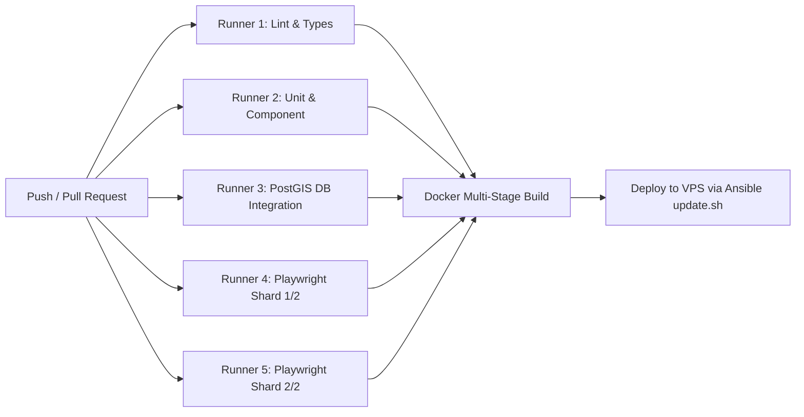

# PEATGUARD (Peatland Early-Warning & Audit Tracking Guard)

[](https://github.com/Alfian57/peat-guard/actions/workflows/build-and-deploy.yml)
[](https://peat-guard.alfian-gading.my.id)
[](#-subtema-karya)

> **Platform WebGIS Full-Stack, Progressive Web App (PWA) Offline-First, dan Sistem Audit Karbon Terdesentralisasi dengan Integrasi Multimodal Artificial Intelligence untuk Mitigasi Kebakaran Lahan Basah Gambut.**

---

## 📌 Informasi Karya & Akses Kompetisi

Karya ini dikembangkan untuk kompetisi **IT RUSH 2026 - Web Development**, diselenggarakan oleh Himpunan Mahasiswa Teknik Informatika (HIMATIF) Universitas Bengkulu.

- **Subtema:** Mitigasi Bencana dan Perubahan Iklim _(relevan juga dengan Lingkungan dan Konservasi)_
- **URL Live Deployment Publik:** [https://peat-guard.alfian-gading.my.id](https://peat-guard.alfian-gading.my.id)
- **Akses Repositori:** Publik ([GitHub Alfian57/peat-guard](https://github.com/Alfian57/peat-guard))

---

## 👥 Akun Uji Coba (Demo Credentials)

Untuk mempermudah dewan juri dalam menguji seluruh peran dan batasan hak akses (_Role-Based Access Control / RBAC_), sistem telah dilengkapi dengan tiga akun terverifikasi. Penguji dapat memasukkan email dan password di bawah ini secara manual pada halaman `/login`.

| Peran (_Role_)                              | Email Akun Demo         | Password   | Ruang Kerja (_Workspace_) | Deskripsi Hak Akses                                                                                                                                  |
| :------------------------------------------ | :---------------------- | :--------- | :------------------------ | :--------------------------------------------------------------------------------------------------------------------------------------------------- |
| **Relawan Lapangan (MPA)**                  | `relawan@gmail.com`     | `password` | `/field/home`             | Pelaporan lapangan _offline-first_, kompresi foto lokal, pengambilan GPS, dan status antrean sinkronisasi.                                           |
| **Koordinator Posko (BPBD/Manggala Agni)**  | `posko@gmail.com`       | `password` | `/command/map`            | _Full-screen WebGIS Command Center_, agregasi titik panas NASA FIRMS, analisis jarak sumber air, dan triase AI.                                      |
| **Verifikator Karbon (Auditor/CSR/Publik)** | `verifikator@gmail.com` | `password` | `/audit/dashboard`        | Dasbor MRV (_Monitoring, Reporting, Verification_), kalkulator deterministik $\text{CO}_2\text{e}$, generator laporan situasi, dan persetujuan zona. |

> **Tips Pengujian Fitur AI Lapangan:**  
> Pada formulir pelaporan relawan (`/field/reports/create`), disediakan tombol **Sampel Foto Uji Coba** (asap pekat kebakaran, sekat kanal kering, dan kondisi aman) agar penguji dapat langsung mengevaluasi analisis _Multimodal AI_ tanpa harus mengunggah foto pribadi.

---

## 📖 Latar Belakang Masalah & Urgensi Solusi

Lahan gambut tropis Indonesia menyimpan cadangan karbon global yang sangat masif, namun rentan mengalami kebakaran bawah permukaan (_ground fire_) yang sulit terdeteksi sejak dini. Terdapat 3 kendala krusial di lapangan:

1. **Titik Buta & Keterlambatan Deteksi Satelit:** Satelit pemantau _hotspot_ memiliki latensi beberapa jam dan kerap terhalang tutupan awan atau kanopi lebat, sehingga api bawah gambut sering terlambat ditangani hingga menjalar luas.
2. **Kendala Sinyal di Area Patroli (_Blank Spot_):** Relawan Masyarakat Peduli Api (MPA) di pedalaman sering tidak memiliki akses internet saat menemukan indikasi awal karhutla atau kerusakan sekat kanal (_canal blocking_).
3. **Ketiadaan Audit Karbon Terpercaya (MRV):** Belum ada sistem verifikasi terstandarisasi berbasis bukti spasial untuk membuktikan pencegahan emisi karbon sebagai dasar pemberian insentif konservasi bagi masyarakat desa.

**PEATGUARD** hadir sebagai solusi terintegrasi: memadukan penginderaan jauh satelit, pelaporan patroli warga berbasis _PWA offline-first_, kecerdasan buatan (_multimodal AI_) untuk memverifikasi keabsahan foto bukti, serta mesin kalkulasi emisi karbon deterministik tanpa halusinasi.

---

## 🚀 Fitur Utama & Integrasi Kecerdasan Buatan (AI)

### 1. WebGIS Command Center & Analisis Spasial Real-Time (PostGIS)

- **Agregasi Data Hotspot Otomatis:** Latar belakang _worker_ secara berkala menyinkronkan data _hotspot_ dari API NASA FIRMS ke dalam basis data PostGIS lokal dengan _advisory lock_ untuk efisiensi kueri tanpa terbentur _rate limit_.
- **Kode Warna Dinamis Tingkat Bahaya:** Menandai insiden lapangan berdasarkan hasil triase AI: **Merah (`KRITIS`)**, **Kuning (`WASPADA`)**, dan **Hijau (`AMAN_TERKENDALI`)**.
- **Perhitungan Jarak Sumber Air Terdekat:** Memanfaatkan fungsi geospasial PostGIS `ST_Distance` untuk menghitung jarak terdekat dari titik kebakaran menuju sumur bor, embung, atau sekat kanal terdekat guna memandu taktik tim pemadam.

### 2. Pelaporan Lapangan Tangguh Putus Koneksi (PWA Offline-First)

- **Geolokasi Presisi & Kompresi Foto di Sisi Klien:** Mengambil koordinat GPS (`navigator.geolocation`) dan waktu kejadian secara otomatis, serta mengompres foto beresolusi tinggi ke format WebP langsung di perangkat pengguna sebelum disimpan.
- **Antrean Lokal IndexedDB:** Jika jaringan terputus (`navigator.onLine === false`), laporan tersimpan secara aman di IndexedDB perangkat dengan status `MENUNGGU_SINKRONISASI`.
- **Sinkronisasi Otomatis:** Saat sinyal kembali tersedia, manajer sinkronisasi secara otomatis mengirimkan antrean ke server dan memicu alur verifikasi AI.

### 3. Triase Visual Laporan Berbasis Multimodal AI (Vision LLM)

- **Validasi keluaran triase.** Foto dengan persetujuan relawan dianalisis menggunakan _Multimodal Vision API_. Server memeriksa keluaran JSON terhadap skema triase sebelum menyimpannya. Posko dapat mencoba ulang analisis yang gagal.
- **Deteksi False Positive & Tingkat Keyakinan:** AI mengevaluasi apakah objek adalah kepulan asap kebakaran gambut nyata, kerusakan sekat kanal, atau sekadar kabut pagi biasa, lengkap dengan skor keyakinan (_confidence score_ 0.0 - 1.0).
- **Rekomendasi Taktis Otomatis:** Menghasilkan 3 langkah mitigasi cepat bagi posko dan tim penindak di lapangan.

### 4. Kalkulator Karbon Deterministik & Log Audit MRV Bebas Halusinasi

- **Perhitungan Emisi Bebas Halusinasi:** Server menghitung estimasi simulasi dengan luas zona × biomassa × faktor emisi × konversi CO₂. Insentif adalah estimasi CO₂e × tarif per ton. Zona konflik dikeluarkan dari total dan parameter berversi dapat ditinjau di ruang kerja Verifikator.
- **Append-Only Evidence Ledger:** Setiap verifikasi patroli, stempel waktu GPS, dan riwayat foto dicatat dalam log audit tak-dapat-diubah (_immutable ledger_) untuk transparansi kredit karbon.

### 5. Generator Laporan Kepatuhan & Situasi Otomatis

- **Sintesis Narasi Eksekutif:** Memanfaatkan AI untuk menyusun narasi laporan situasi lapangan berdasarkan statistik faktual yang teragregasi dari basis data.
- **Pratinjau & Ekspor Dokumen:** Posko dan Verifikator dapat membuat pratinjau laporan situasi harian atau audit karbon bulanan. Verifikator dapat menerbitkan pratinjau ke arsip internal dengan unduhan PDF.

---

## 🛠️ Tech Stack & Deklarasi Penggunaan Sumber Daya

Sesuai ketentuan **Poin V.5 Guidebook IT RUSH 2026**, berikut rincian penggunaan framework, library, aset terbuka, dan asisten AI:

### A. Arsitektur & Teknologi Utama

- **Frontend:** Next.js 16 (App Router), React 19, TypeScript (Strict Mode).
- **Styling & Antarmuka:** Tailwind CSS, Radix UI / Base UI primitives, Lucide Icons, Class Variance Authority (`cva`).
- **Peta & WebGIS:** MapLibre GL JS (vektor tile interaktif, poligon zona gambut, marker clustering).
- **Basis Data & Spasial:** PostgreSQL 17 dengan ekstensi **PostGIS 3.7**, diakses melalui **Prisma ORM 7** dengan PostgreSQL adapter.
- **Autentikasi & Keamanan:** Better Auth dengan session cookies terenkripsi, proteksi CSRF, Same-Origin validation, dan RBAC (`requireRole`).
- **Pengolahan Citra:** Sharp (server-side image normalizer) dan HTML5 Canvas API (client-side compression).
- **Runtime & Tooling:** Bun 1.3.1 dan Node.js 22 LTS.

### B. Layanan Eksternal & Aset Terbuka (Open-Source)

- **NASA FIRMS API:** Sumber data penginderaan satelit titik panas MODIS dan VIIRS.
- **MapTiler Cloud:** Peta dasar (_basemap_) vektor geospasial.
- **OpenStreetMap Data:** Batas geografis dan referensi spasial terbuka.

### C. Artificial Intelligence Engine

- **Vision & LLM Reasoning:** DeepSeek Multimodal Vision API dengan pemeriksaan keamanan penyedia dan validasi keluaran di server.
- **AI Coding Assistant Disclosure:** Selama proses perancangan dan pengembangan perangkat lunak, tim memanfaatkan **Google Antigravity Agentic AI** sebagai asisten coding untuk membantu perancangan struktur arsitektur, implementasi boilerplate, refaktorisasi pola _1 File = 1 Component_, pembuatan suite pengujian otomatis, dan konfigurasi GitHub Actions CI/CD.

---

## 🧪 Kualitas Source Code, Testing & CI/CD Pipeline

Untuk menjamin keandalan sistem pada standar industri (_enterprise-grade_), PEATGUARD dilengkapi dengan pipeline **GitHub Actions CI/CD Multi-Runner** yang terbagi ke dalam 5 runner independen dengan _Horizontal Sharding_:



1. **Runner 1: Linting & Analisis Statis** (`lint-and-static-analysis`)
   - Memvalidasi kualitas kode dengan ESLint, Prettier format check, dan `tsc --noEmit` tipe data ketat tanpa toleransi `any` implisit.
2. **Runner 2: Unit & Component Testing** (`unit-and-component-tests`)
   - Menjalankan pengujian unit dan komponen dengan Bun dan Testing Library, termasuk formula karbon, parsing CSV FIRMS, otorisasi RBAC, dan state PWA.
3. **Runner 3: PostGIS Spatial Integration** (`database-and-spatial-integration`)
   - Menjalankan kontainer layanan PostGIS riil (`postgis/postgis:17-3.7`), migrasi database, seeding, dan pengujian fungsi spasial (`ST_DWithin`, `ST_Distance`).
4. **Runner 4 & 5: End-to-End Playwright Tests (Horizontal Sharded)** (`e2e-playwright-shards`)
   - Menjalankan Playwright pada build produksi di dua runner paralel. Cakupan meliputi PWA saat jaringan browser diputus, navigasi seluler, persetujuan zona, dan audit aksesibilitas.
5. **Continuous Deployment (CD) Zero-Downtime:**
   - Image Docker di-build dengan multi-stage caching, diunggah ke GitHub Container Registry (`ghcr.io/alfian57/peat-guard`), dan dideploy ke server VPS menggunakan helper script `update.sh` yang terintegrasi dengan arsitektur **Ansible**.

---

## 💻 Panduan Menjalankan Aplikasi Secara Lokal (Development Setup)

### Prasyarat Sistem

- **Docker** dan **Docker Compose** (versi modern dengan plugin `docker compose`)
- **Bun** (v1.3.1+) atau Node.js (v22+)

### Langkah Instalasi

1. **Kloning Repositori:**

   ```sh
   git clone https://github.com/Alfian57/peat-guard.git
   cd peat-guard/peat-guard-web
   ```

2. **Salin Environment Variables:**

   ```sh
   cp .env.example .env
   ```

   _(Opsional: Isi `DEEPSEEK_API_KEY`, `NASA_FIRMS_MAP_KEY`, dan `NEXT_PUBLIC_MAPTILER_KEY` untuk menguji integrasi pihak ketiga secara penuh. Tanpa API key tersebut, data demo tetap tersedia dan integrasi terkait menampilkan status layanan)._

3. **Jalankan Aplikasi dengan Docker Compose:**

   ```sh
   docker compose -f docker/compose.dev.yaml -p peatguard-main up --build
   ```

   _Perintah ini akan secara otomatis menyalakan basis data PostgreSQL + PostGIS, menjalankan migrasi database Prisma, memasukkan data benih (seed) demo, dan menjalankan server Next.js pada port `3000`._

4. **Buka Aplikasi di Browser:**
   Akses `http://localhost:3000` dan masuk menggunakan akun demo yang tertera di atas.

5. **Menjalankan Pengujian Otomatis (Testing Suite):**
   ```sh
   # Menjalankan pengujian unit dan komponen
   bun run test:unit

   # Menjalankan pengujian integrasi database PostGIS
   bun run test:integration

   # Menjalankan seluruh pengujian Playwright, termasuk service worker PWA
   bun run build
   E2E_PRODUCTION=1 bun run test:e2e
   ```

Untuk rilis dengan basis data yang sudah ada, jalankan `bun run db:migrate:deploy` pada basis data tujuan sebelum menjalankan aplikasi dan worker versi baru.

---

## 📂 Struktur Direktori Proyek

```text
peat-guard-web/
├── .github/workflows/       # Pipeline CI/CD GitHub Actions multi-runner
├── app/                     # Next.js 16 App Router (Clean Routing: /field, /command, /audit)
│   ├── (audit)/             # Workspace Verifikator Karbon & Transparansi MRV
│   ├── (command)/           # Workspace Koordinator Posko & WebGIS Command Center
│   ├── (field)/             # Workspace Relawan Lapangan PWA Offline-First
│   ├── api/                 # Endpoint RESTful API & Server Actions
│   └── login/               # Halaman autentikasi dengan selector demo
├── components/              # Komponen UI modular (Prinsip Ketat: 1 File = 1 Component)
│   ├── audit/               # Antarmuka MRV ledger, preview dokumen, kalkulator karbon
│   ├── command/             # WebGIS inspector, marker renderer, filter dialogs
│   ├── field/               # PWA offline report form, sample photos, status pill
│   └── ui/                  # Desain sistem atomik berbasis Radix / Base UI
├── docker/                  # Konfigurasi containerization terpusat
│   ├── Dockerfile           # Multi-stage production container (Next.js + worker)
│   ├── compose.dev.yaml     # Local development PostGIS & web container
│   └── entrypoint.sh        # Dual-process supervisor (Next.js + background worker)
├── e2e/                     # Suite pengujian Playwright End-to-End
├── lib/                     # Utilitas inti, klien Prisma, kontrak rute terpusat, autentikasi
├── prisma/                  # Skema database relasional & PostGIS, migrasi, dan seeder
├── public/                  # Aset statis dan manifest Progressive Web App
└── test/                    # Suite pengujian unit & integrasi Bun Test
```

---

## 📄 Lisensi & Pernyataan Orisinalitas

Karya ini dikembangkan secara orisinal oleh tim pengembang untuk ajang **IT RUSH 2026**. Seluruh kode sumber, aset, dan skema arsitektur dirancang dengan mematuhi prinsip kejujuran akademik, etika pengembangan perangkat lunak, dan ketentuan yang ditetapkan panitia.

_Hak Cipta © 2026 PEATGUARD Team. Dilisensikan di bawah [MIT License](LICENSE)._
